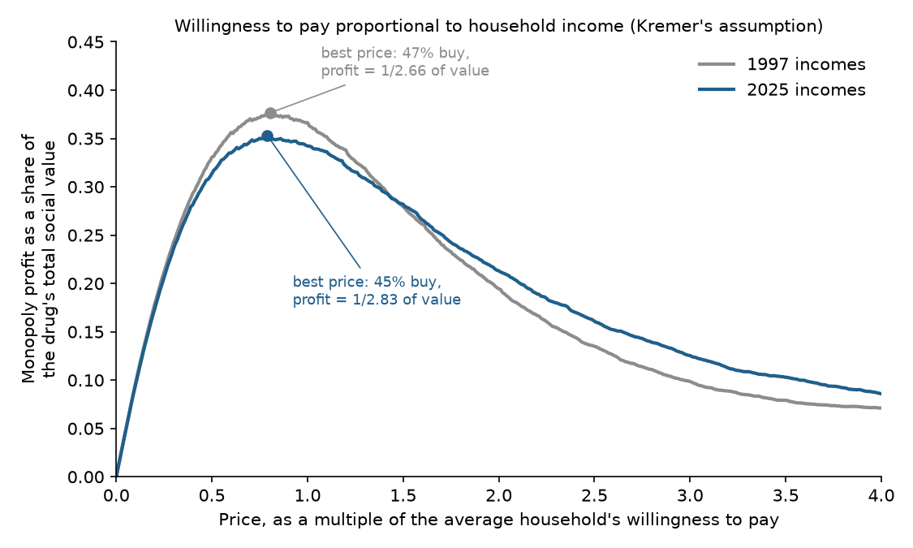
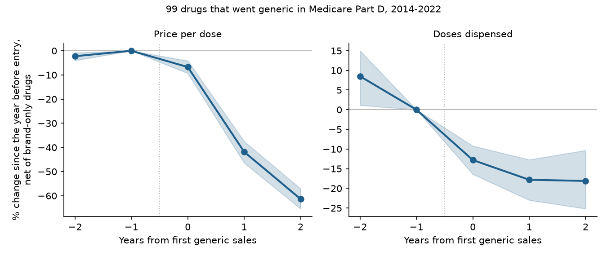
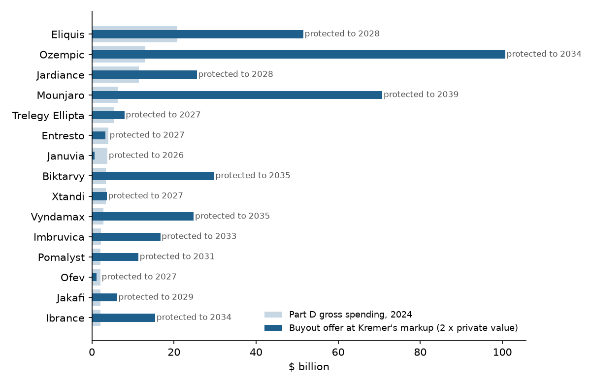

# Buying Patents and Giving Them Away

### In 1998 Michael Kremer proposed that governments buy drug patents at an auction price times two and release the inventions to anyone who wants to make them. I asked again what that would buy and what it would cost, using today's incomes and today's Medicare data.

---

In 2024 Medicare's drug program paid for 2.16 billion tablets of Eliquis, the blood thinner made by Bristol Myers
Squibb, at an average gross cost of $9.63 a tablet. The bill came to $20.8 billion, more than Part D spent on any
other drug. Eliquis was approved in December 2012. Its compound patent, as listed with the Food and Drug
Administration, runs to November 2026, and the last exclusivity on that listing runs to October 2028. In 2024 no
one else sold apixaban to Medicare patients.

What happens afterwards has happened to dozens of drugs in the same program. Lyrica,
the nerve-pain pill, cost Part D $7.54 a dose in 2018. Generics arrived in 2019, and by 2021, with 21 makers
selling them, the average dose cost $0.84. Crestor, AstraZeneca's cholesterol pill, went from $6.92 a dose to
$0.87 the same way.

The patent is the price society pays for the drug having been invented at all, since nobody pays for years of
clinical trials on a molecule a rival can copy the day it is approved. Michael Kremer, then a young economist at MIT,
suggested a way to keep the reward and drop the high price. The government would buy the patent, pay the inventor
more than it was worth to him, and let every generic maker in the country start production the next morning.

---

## Two numbers that decide the deal

Kremer's offer has one formula. An auction among firms that would like to own the patent reveals its private
value, the present value of the monopoly profit it will earn. The government offers that value times a fixed
markup:

```math
B = M \times \hat{V}, \qquad \hat{V} = \sum_{t=1}^{T} \frac{\pi_t}{(1+r)^t}
```

Here $`B`$ is the buyout price, $`M`$ the markup (Kremer suggested two), $`\hat{V}`$ the private value, $`\pi_t`$
the monopoly profit in year $`t`$, $`T`$ the years of protection left and $`r`$ the discount rate. For Eliquis I
measure the yearly profit as the part of its Part D spending that disappears when generics arrive, 67.9% on the
evidence below, which is $14.10 billion a year. Discounted at 7% over the 2.0 years of protection that remain:

```math
B_{\text{Eliquis}} = 2 \times \$25.77\text{ billion} = \$51.54\text{ billion}
```

The markup is there because the inventor's profit understates what the drug is worth to everyone else. Kremer's
case for "perhaps two" rests on a second number, the ratio of a drug's social value to its monopoly profit. Social
value is what all buyers together would pay rather than go without, less the cost of making the drug:

```math
\rho = \frac{SV}{\pi}, \qquad SV = \pi + CS + DWL, \qquad
d = \frac{DWL}{\pi + CS}
```

$`CS`$ is consumer surplus, the value buyers get above what they pay, and $`DWL`$ is the deadweight loss, the value
lost from people who would gladly pay the cost of making the drug but not the monopoly price. The share $`d`$ is
the fraction of the drug's realized value that monopoly pricing throws away.

Kremer computed both numbers under one crude assumption, that every household would pay for a new drug in
proportion to its income. Suppose each household would pay 1% of its income, and the seller can charge only one
price. With 2025 incomes the average household would pay $1,267. The profit-maximizing price turns out to be
$1,000, which 44.7% of households pay. Per household in the country, that earns $447 of profit, leaves $551 of
consumer surplus and loses $268 of value from households priced out:

```math
\rho_{2025} = \frac{\$1{,}267}{\$447} = 2.83, \qquad
d_{2025} = \frac{\$268}{\$447 + \$551} = 0.269
```

The ratio depends only on the shape of the income distribution, not on its level.

| Who wants the drug | Best single price | Social value ÷ profit |
|---|---|---|
| Every household has the same income | Everyone's full valuation | 1.00 |
| US households, 1997 incomes | 0.80 × the average valuation | 2.66 |
| US households, 2025 incomes | 0.79 × the average valuation | 2.83 |

---

## Michael Kremer and the Daguerreotype

Michael Kremer was born in New York in 1964 and took his doctorate in economics at Harvard in 1992. He was teaching
at MIT when he wrote "Patent Buyouts: A Mechanism for Encouraging Innovation," which appeared in the *Quarterly
Journal of Economics* in 1998. He moved to Harvard in 1999 and in 2019 shared the Nobel Prize in economics
with Abhijit Banerjee and Esther Duflo for experimental work on global poverty. He is now a University Professor at
the University of Chicago.

The paper opens in Paris. In 1839 the French government bought Louis Daguerre's process for making photographs for
a pension of 6,000 francs a year and placed it in the public domain everywhere but England. Within months, Kremer
notes, the manual had been translated into a dozen languages. His second example is Eli Whitney, who sold the South Carolina rights to his cotton gin to the state for
$50,000 in 1802 and was then refused the balance and arrested, a warning that any buyout has to be voluntary.

The mechanism he proposed has three steps. Firms bid for the patent in a sealed-bid auction. The government offers
the inventor the auction value times the markup, and the inventor may refuse and keep the patent. If he sells, the
government places the patent in the public domain, except that with a small probability $`p`$ it sells the patent
to the highest bidder at the second-highest bid, which is what keeps bids honest. The markup also cures a lemons problem. If the
inventor knows the patent's true value and bidders only know it lies between $`L`$ and $`U`$, Kremer's equation (1)
gives the equilibrium bid:

```math
\text{bid} = \min\left(\frac{L+U}{2},\ \max\left[0,\ \frac{L}{2-M}\right]\right)
```

With no markup ($`M = 1`$) bidders offer only $`L`$ and no inventor sells. With $`M = 2`$ they bid the midpoint,
the government offers $`L + U`$, and every patent is sold.

The headline numbers come from the calculation above, which the paper credits to Atif Mian. It reports that the social value of new drugs is 2.6 times the profit of a
monopolist who cannot price discriminate, and that the deadweight loss is one quarter of profits plus consumer
surplus. Kremer then chains three factors, twice for spillovers at monopoly quantities, four-thirds because a
quarter of research money duplicates existing products, and five-fourths for the deadweight loss, to reach 3.33
times the private return. He settled on two as a conservative markup and named pharmaceuticals as the place to try
it first.

The central result is a short piece of algebra. Assume each household $`i`$ values the drug at $`v_i = k\,y_i`$,
where $`y_i`$ is its income and $`k`$ is the same for everyone, that the drug costs nothing to make, and that the
seller sets one price. Let $`S(p)`$ be the share of households with $`v_i \ge p`$ and $`f`$ its density:

```math
\begin{aligned}
\pi(p) &= p\,S(p) \\
0 &= S(p^*) - p^* f(p^*) \\
p^* &= k\,y^*, \qquad S(p^*) = \Pr(y \ge y^*) \\
\rho &= \frac{k\,\mathbb{E}[y]}{k\,y^*\Pr(y \ge y^*)}
= \frac{\mathbb{E}[y]}{y^*\Pr(y \ge y^*)}
\end{aligned}
```

The scale $`k`$ cancels, so the ratio of social value to profit is a property of the income distribution alone,
and anyone with Census microdata can recompute it.

The strongest objection is the one Kremer raised himself. A patent holder who receives the full offer whenever the
patent is bought, while the bidder pays only in the rare case he wins, has every reason to bribe bidders to bid
high. Steven Shavell and Tanguy van Ypersele, writing in the *Journal of Law and Economics* in 2001, concluded that
an optional reward system can do better than patents, but that the principal difficulty with rewards is the
information needed to set them. Kremer later carried the idea into advance market
commitments, and in 2009 donors pledged $1.5 billion to buy pneumococcal vaccines for poor countries on that model.

---

## How I tested it

The replication follows the paper's assumptions, but the paper does not say which income data it used, so the
data are my choice. I took every household in the Census Bureau's March Current Population
Survey for income year 1997, the year closest to the paper, and for 2025, the latest, weighted them to the national
totals of 102.6 million and 137.1 million households, and found the single price that maximizes profit when each
household's valuation is proportional to its income. Kremer does not say whether Mian counted households or
people, so I report both, along with an income measure adjusted for household size. I drew 500 bootstrap samples of
households to put intervals on the main numbers.

For the extension I treated generic entry as a natural experiment in giving a patent away. From the Medicare Part
D Spending by Drug files for 2012 to 2024 I selected molecules where generics supplied under 5% of doses in the two
years before entry and at least half in the two years after, with at least $10 million of spending the year
before. I kept only those sold mainly as tablets or capsules, using the FDA's Orange Book, so that a dose means a
pill. That leaves 99 drugs that went generic between 2014 and 2022. For each I compare the change in price per dose
and in doses from the year before entry to two years after:

```math
\begin{aligned}
\Delta_i &= \ln p_{i,E_i+2} - \ln p_{i,E_i-1} \\
\widehat{\delta}_i &= \Delta_i - \frac{1}{|C_{E_i}|} \sum_{j \in C_{E_i}} \Delta_j \\
R_i &= 1 - e^{\widehat{\delta}_i}
\end{aligned}
```

$`E_i`$ is the year generics first sold, $`p`$ is gross Part D spending per dose and $`C_E`$ is the set of control
drugs. For prices the controls are brand-only pills over the same five years, which nets out list-price increases.
For doses, which I treat the same way with $`\ln q`$, they are pills that were generic all along, since young
brand drugs are still gaining patients. $`R_i`$ is the share of the brand's price that disappears, my measure of the
monopoly rent per dollar of spending. I average price falls across drugs weighting by pre-entry spending, and dose
changes weighting by the rent at stake, and take 2,000 bootstrap draws over drugs for intervals. To test Kremer's claim that drug markets would be competitive without
patents, I regress the price change on the number of generic makers, with entry-year fixed effects and
heteroskedasticity-robust (HC1) standard errors:

```math
\widehat{\delta}_i = \alpha + \beta \ln N_i + \gamma_{E_i} + \varepsilon_i,
\qquad H_0:\ \beta = 0
```

Finally I priced Kremer's buyout for every brand drug that had no generic in Part D in 2024, that I could match to
the Orange Book, that lists a compound patent there, and whose compound patent or new-chemical, orphan or
pediatric exclusivity was still in force on October 9, 2026. The private value is that drug's 2024 spending times the average rent share, held flat and
discounted at 7% to the last of those dates.

---

## Kremer's 2.6 holds up, and inequality has pushed it to 2.8

| Income year and unit | Social value ÷ profit | Deadweight loss ÷ (profit + consumer surplus) | Share who buy at the best price |
|---|---|---|---|
| Kremer (1998), as published | 2.6 | 0.25 | not reported |
| 1997, households | 2.66 | 0.275 | 46.8% |
| 1997, people | 2.75 | 0.244 | 50.2% |
| 2025, households | 2.83 | 0.269 | 44.7% |
| 2025, people | 2.83 | 0.269 | 46.6% |

With 1997 incomes the calculation lands at 2.66 against the published 2.6, and the deadweight share at 0.275
against one quarter. In formal terms, for households:

```math
\begin{aligned}
\hat{\rho}_{1997} &= 2.66\ [2.63,\ 2.68], \quad \hat{d}_{1997} = 0.275\ [0.269,\ 0.282] \\
\hat{\rho}_{2025} &= 2.83\ [2.80,\ 2.86], \quad \hat{d}_{2025} = 0.269\ [0.262,\ 0.275]
\end{aligned}
```

The intervals do not overlap. Incomes have spread out, so a seller holding one price now captures 35.3%
of a drug's value instead of 37.7%. Running Kremer's chain with the 1997 deadweight share gives 3.40 rather than
his 3.33. A production cost equal to 30% of the monopoly price raises the 2025 household ratio to 3.00. At 40% the best
single price jumps to one only the richest half percent of households pay, an answer resting on the top-coded
tail of the survey that I do not treat as informative.



---

## Generic entry delivers the price Kremer promised

Two years after generics arrive, the gross price per dose of the 99 drugs is 67.9% lower than it would have been,
weighting by spending, net of what happened to brand-only drugs. The simple average is 55.5%. In the year before entry
the controlled log price fell by only 0.023.

| Drug that went generic | Brand's application holder | Year | Price per dose before | Two years after | Generic makers |
|---|---|---|---|---|---|
| Lyrica (pregabalin) | Upjohn | 2019 | $7.54 | $0.84 | 21 |
| Crestor (rosuvastatin) | AstraZeneca | 2016 | $6.92 | $0.87 | 22 |
| Abilify (aripiprazole) | Otsuka | 2015 | $30.04 | $9.65 | 14 |
| Cymbalta (duloxetine) | Eli Lilly | 2014 | $6.96 | $1.21 | 16 |
| Nexium (esomeprazole) | AstraZeneca | 2015 | $7.81 | $4.45 | 6 |

The size of the fall depends on how many firms enter, which is the competition Kremer was counting on.

| Generic makers two years after entry | Drugs | Median price fall |
|---|---|---|
| 1 or 2 | 15 | 26.0% |
| 3 to 5 | 23 | 41.2% |
| 6 to 9 | 33 | 67.5% |
| 10 or more | 28 | 76.4% |

```math
\hat{\beta} = -0.569\ (0.055), \quad 95\%\ \text{CI}\ [-0.676,\ -0.462], \quad N = 99
```

The coefficient is an elasticity. A drug with 1% more generic makers ends up with a price about 0.57% lower, and
with a t-statistic of -10.4 the relationship is not chance. Kremer warned that buyouts suit drugs that are easy
to make, and the 15 drugs that drew only one or two makers saw a median fall of only 26.0%.



---

## Use barely rises when the price falls

The second half of the promise is that use rises once the price falls. Weighting by
the rent at stake, doses two years after entry are 2.6% above the comparison drugs, with an interval from 11.9%
below to 15.8% above. The typical drug lost ground, and as the figure above shows, it
was already losing ground before generics arrived.

With demand drawn as a straight line between the before and after points, and the generic price taken as the cost
of making the drug, the deadweight loss recovered per dollar of monopoly rent is half the percentage rise in use:

```math
\frac{DWL_i}{\text{rent}_i} = \frac{\tfrac{1}{2}(p_0 - p_1)(q_1 - q_0)}{(p_0 - p_1)\,q_0} = \frac{x_i}{2},
\qquad x_i = \frac{q_1 - q_0}{q_0}
```

The income calculation implies that each dollar of monopoly profit comes with 57 cents of deadweight loss in 1997
and 60 cents in 2025. The Medicare data give 1.3 cents, with an interval from minus 6.0 to plus 7.9 cents. Even if I
extend each drug's own pre-entry decline forward, which is generous, the figure is 15.9 cents, with use rising 31.9%.

| Deadweight loss per $1 of monopoly profit | Estimate |
|---|---|
| Income-proportional valuations, 1997 households | $0.57 |
| Income-proportional valuations, 2025 households | $0.60 |
| Part D generic entries, against long-generic drugs | $0.013 |
| Part D generic entries, extending each drug's prior trend | $0.159 |

Kremer's calculation assumes patients face the price. In Part D they face a copay or coinsurance and the plan pays
the rest, which is the likeliest reason a patient fills the prescription largely whatever the plan is billed. I
cannot test that here. Either way, in these data the monopoly price moves money from enrollees and taxpayers to
the patent holder but shuts few people out of treatment.

---

## Buying out Medicare's patented drugs would cost about $720 billion

| Drug | Maker | Part D spending, 2024 | Protected until | Buyout offer at 2 × value |
|---|---|---|---|---|
| Eliquis | Bristol Myers Squibb | $20.8 billion | Oct 2028 | $51.5 billion |
| Ozempic | Novo Nordisk | $13.0 billion | May 2034 | $100.7 billion |
| Jardiance | Boehringer Ingelheim | $11.4 billion | Aug 2028 | $25.6 billion |
| Mounjaro | Eli Lilly | $6.3 billion | Jun 2039 | $70.8 billion |
| Trelegy Ellipta | GSK | $5.3 billion | Dec 2027 | $7.9 billion |
| Entresto | Novartis | $4.0 billion | May 2027 | $3.3 billion |
| Januvia | Merck | $3.8 billion | Nov 2026 | $0.6 billion |
| Biktarvy | Gilead | $3.5 billion | Jun 2035 | $29.8 billion |

These are the eight protected brands with the most Part D spending in 2024. Mounjaro, with half of Jardiance's
spending and far more years left, would cost almost three times as much.
For 22 of the 327 drugs, Eliquis among them, the end date comes from an exclusivity rather than the compound patent,
and they account for $81.3 billion of the offers. Eliquis's is a pediatric extension of a three-year exclusivity
for a new patient group, which on its own would not keep generic apixaban off the market for adults. Its compound
patent expires on November 21, 2026, six weeks after the October 9 date from which I count years left.

Across all 327 brand drugs that pass my rules, Part D spent $143.5 billion in 2024, half of the program's $288.7
billion. Their combined private value is $360.0 billion, and Kremer's offer doubles it to $720.0 billion. The
uncertainty in the rent share moves that total between $650.6 billion and $780.9 billion, and a 3% discount rate
raises it to $835.5 billion.

Because Medicare already pays the monopoly price on these drugs, the buyout's net cost is smaller than the check.
Half of the offer repays rent the program would have paid anyway, so the extra $360.0 billion is the reward Kremer
wants added to the inventors' incentive. The deadweight loss it would recover is $4.7 billion in present value on
my main estimate, or $57.3 billion on the generous one.

The trial Kremer proposed was modest. He suggested appropriating $100 million over two years once a foundation had
shown the idea could work. At his markup, $100 million buys 1.3 days of Eliquis's remaining protection.



---

## Why it matters

For patients, a buyout would end the high price at once, and the price would fall about as far as it does at
generic entry. In Medicare the gain would show up mostly as lower premiums and copays rather than as more
people taking the drug. Uninsured patients and people abroad may gain more.

For taxpayers, the buyout trades a stream of payments for a lump sum. Its net cost of $360.0 billion compares with
$143.5 billion a year that Part D now spends on the same drugs.

For drug makers, the markup is the point. A company that develops a drug like Eliquis would receive twice what
the patent would earn, closer to a social value that the income data put at 2.66 to 2.83 times profit.

For policy, the evidence moves the case for buyouts away from where Kremer placed it. In an insured market the
static deadweight loss is small, so the argument has to rest on paying inventors closer to what their drugs are
worth and ending wasteful copycat research, which is the half of the proposal the data here cannot test.

---

## Limits of this study

Part D spending is gross of the rebates manufacturers pay to plans, which CMS does not publish drug by drug, so
brand prices and the rent share are overstated and the bill is an upper bound. The rent share comes from pills that
went generic and may not fit injectables like Ozempic or Mounjaro. A patent date in the Orange Book is not the day
generics arrive, since settlements can delay entry past expiry and courts can strike patents earlier, and FDA has
already approved generic versions of 9 of the 15 largest drugs. The dose comparison depends on the control drugs,
and the two versions I report bracket a wide range. A real buyout would also have to price the rest of the American
market and the rights abroad. And the replication shares Kremer's crude assumption,
that willingness to pay is proportional to income, which no one believes. It shows the paper's arithmetic
is right, not that its premise describes how people value medicine.

---

## Further reading

- [TECHNICAL.md](TECHNICAL.md) covers the data, the rules, every test statistic and how to reproduce the results.
- [results/FINDINGS.md](results/FINDINGS.md) has a plain-English summary and every table the scripts produce.
- [METHODS_REVIEW.md](METHODS_REVIEW.md) is a methods and reporting review of the original paper.
- Michael Kremer, "Patent Buyouts: A Mechanism for Encouraging Innovation," *Quarterly Journal of Economics*
  113(4), November 1998, pp. 1137-1167. The working paper version is NBER Working Paper 6304, December 1997.
- Steven Shavell and Tanguy van Ypersele, "Rewards versus Intellectual Property Rights," *Journal of Law and
  Economics* 44(2), 2001, pp. 525-547.
- US Census Bureau, Current Population Survey Annual Social and Economic Supplement, March 1998 and March 2026
  public-use files.
- Centers for Medicare & Medicaid Services, Medicare Part D Spending by Drug, releases for 2016 to 2024.
- US Food and Drug Administration, Orange Book data files (products, patents, exclusivities), October 2026.

*Brendyn Beasley*
